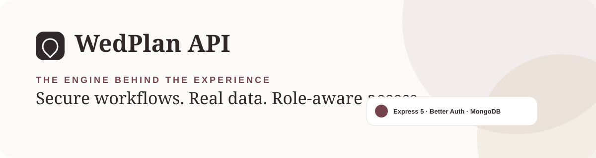
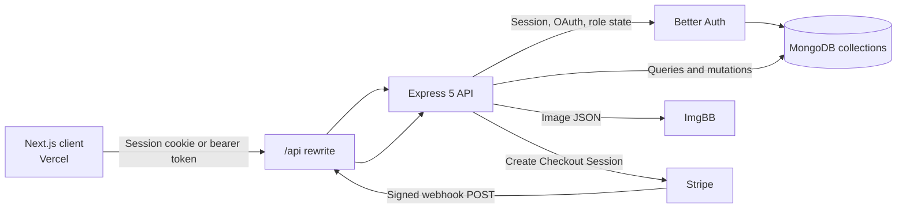
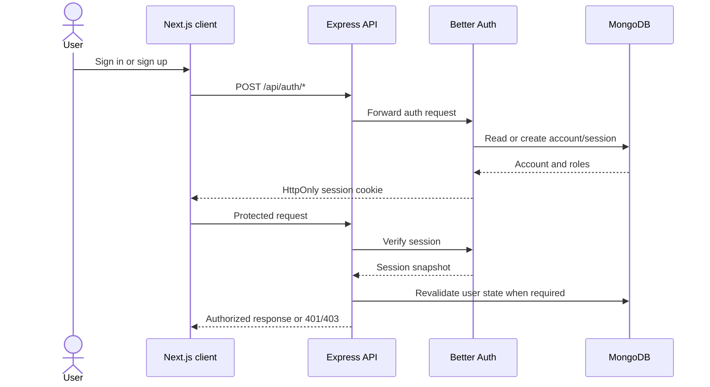
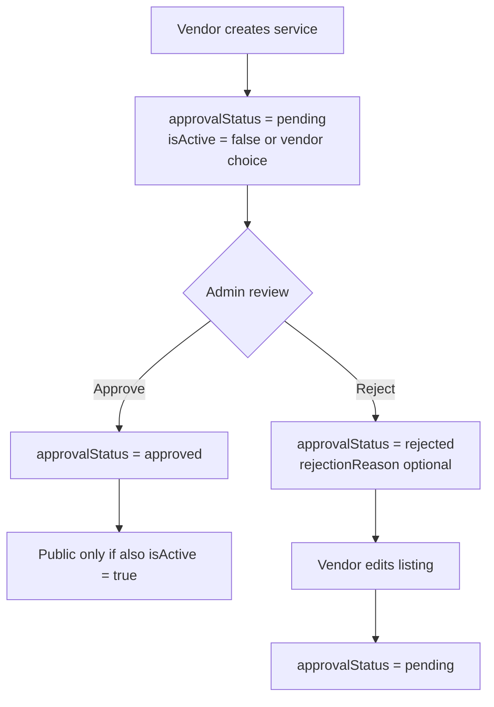
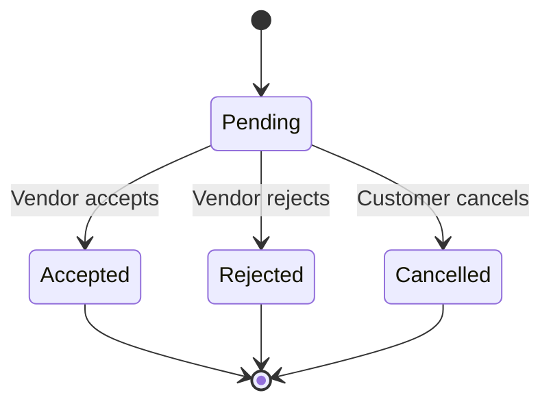
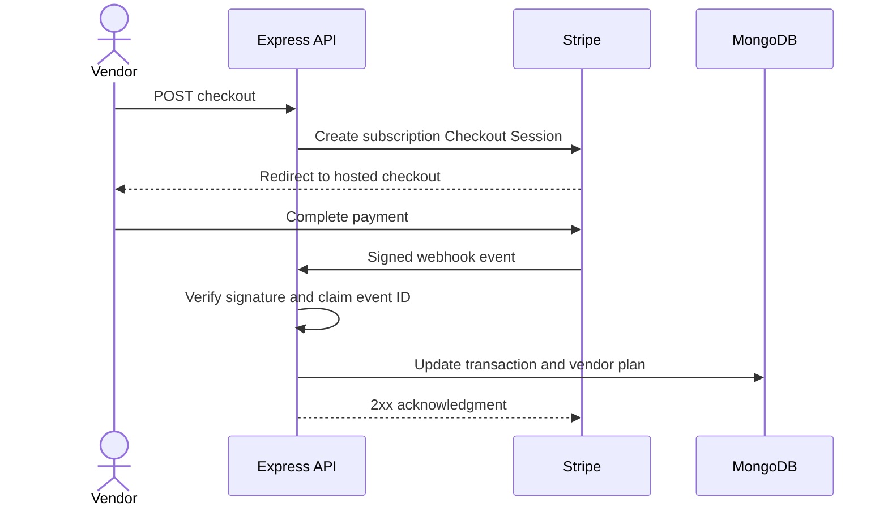
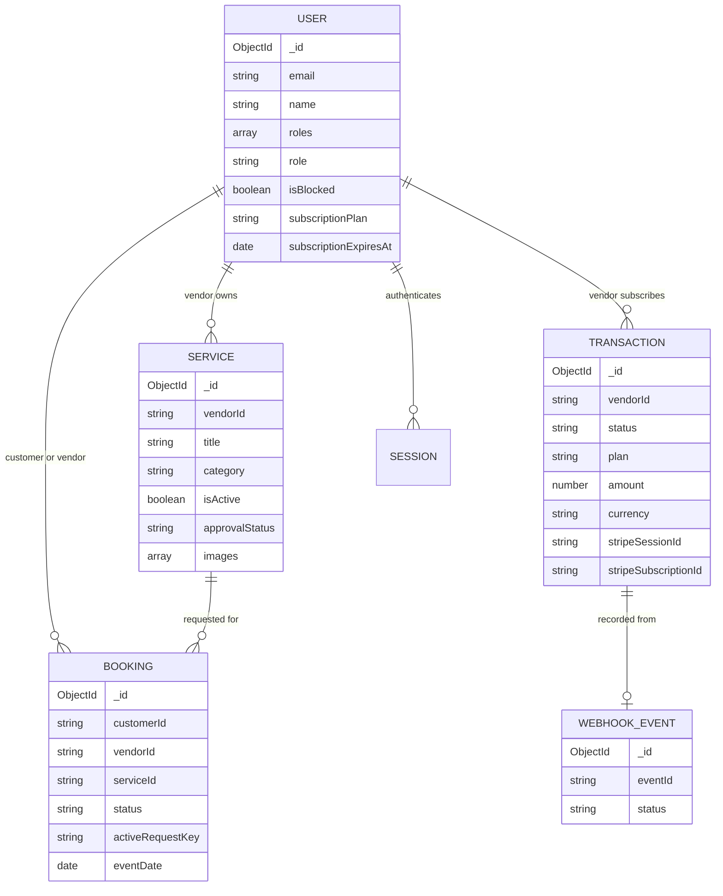

# WedPlan API

<p align="center">
  
</p>

<p align="center">
  <strong>The role-aware backend behind wedding discovery, bookings, moderation, and subscriptions.</strong>
</p>

<p align="center">
  <a href="https://wedplan-server-vcdp.onrender.com/api/health"><strong>API health</strong></a>
  ·
  <a href="https://wedplan-client-ten.vercel.app"><strong>Live client</strong></a>
  ·
  <a href="#quick-start"><strong>Local setup</strong></a>
  ·
  <a href="https://github.com/afiaafia/wedplan-client"><strong>Client repository</strong></a>
</p>

WedPlan Server is an Express 5 and TypeScript API for the WedPlan wedding planning platform. It combines Better Auth sessions, role and ownership checks, MongoDB-backed marketplace data, ImgBB image uploads, and Stripe subscription webhooks.

| Service | URL |
| --- | --- |
| Production API | [wedplan-server-vcdp.onrender.com](https://wedplan-server-vcdp.onrender.com) |
| Live client | [wedplan-client-ten.vercel.app](https://wedplan-client-ten.vercel.app) |
| Health | [GET /api/health](https://wedplan-server-vcdp.onrender.com/api/health) |
| Server repository | [afiaafia/wedplan-server](https://github.com/afiaafia/wedplan-server) |

---

## Backend architecture



The API validates JSON and route parameters with Zod, applies Helmet and a CORS allowlist, derives identity from Better Auth sessions or short-lived bearer JWTs, then applies role middleware and resource ownership checks.

---

## Core workflows

### Authentication and authorization



Accounts use a normalized `roles` array. The legacy `role` field remains as a compatibility field. Public registration accepts only Customer or Vendor intent; registration and OAuth account creation cannot assign Admin.

Every protected middleware rejects blocked accounts. Route middleware then requires Customer, Vendor, or Admin access. Vendor and Customer operations are scoped to the session-derived user ID. Admin operations require an active Admin session.

### Service moderation



Approval never changes `isActive`. Public service queries require both `approvalStatus: "approved"` and `isActive: true`.

### Booking lifecycle



Booking identity and status ownership are server-controlled. Duplicate active requests for the same customer, service, and event date are rejected. A unique partial MongoDB index reinforces the application check.

### Stripe subscription flow



Only verified Stripe webhook events activate Premium. Client success/cancel redirects do not themselves change subscription state.

---

## Authentication and security

- Better Auth uses the MongoDB adapter.
- Email/password policy requires 6–128 characters with uppercase and lowercase characters.
- Google OAuth is configured when Google credentials are present.
- Better Auth sessions are HttpOnly and cookie-cache-disabled.
- `roles` is the authorization source of truth; legacy `role` is retained for compatibility.
- Middleware derives identity from the session or signed bearer token instead of request-supplied ownership.
- Blocked accounts receive `403 ACCOUNT_BLOCKED`.
- Role middleware rejects unauthorized requests with `403`.
- Zod rejects malformed parameters and unknown or invalid request fields according to the route validator.
- Helmet is enabled and CORS uses an explicit origin allowlist.
- Stripe webhook payloads are processed from the raw body and verified with the signing secret.
- Webhook event IDs are claimed idempotently and stale processing records can be reclaimed.
- Image uploads stay server-side; MongoDB stores the hosted ImgBB URLs rather than raw image data.

Security-sensitive values remain server-only and must not be placed in `NEXT_PUBLIC_*` variables or source control.

---

## API route overview

The API uses an envelope such as:

```json
{
  "success": false,
  "error": {
    "code": "VALIDATION_ERROR",
    "message": "Invalid request parameters",
    "details": []
  }
}
```

### Authentication and profile

| Method | Path | Access | Purpose |
| --- | --- | --- | --- |
| `ALL` | `/api/auth/*splat` | Public | Better Auth auth, session, OAuth, and account operations |
| `GET` | `/api/me` | Session | Current profile |
| `POST` | `/api/me/token` | Session | Issue a 15-minute API bearer token |
| `POST` | `/api/me/roles/vendor` | Authenticated Customer | Add Vendor capability to the current account |
| `PATCH` | `/api/me` | Session | Update the current profile |
| `POST` | `/api/me/image` | Session | Upload a profile image to ImgBB |

### Public services

| Method | Path | Access | Purpose |
| --- | --- | --- | --- |
| `GET` | `/api/services` | Public | Browse approved, active services |
| `GET` | `/api/services/featured` | Public | Get database-backed featured services |
| `GET` | `/api/services/:id` | Session | Get an approved, active service detail |

### Customer

| Method | Path | Access | Purpose |
| --- | --- | --- | --- |
| `POST` | `/api/bookings` | Customer | Create a booking request |
| `GET` | `/api/customer/dashboard` | Customer | Dashboard totals and recent bookings |
| `GET` | `/api/customer/bookings` | Customer | Booking history |
| `GET` | `/api/customer/bookings/:id` | Customer | Booking detail |
| `POST` | `/api/customer/bookings/:id/cancel` | Customer | Cancel a Pending booking |
| `GET` | `/api/customer/profile` | Customer | Customer profile |
| `PATCH` | `/api/customer/profile` | Customer | Update customer profile |
| `POST` | `/api/customer/profile/image` | Customer | Upload customer profile image |

### Vendor

| Method | Path | Access | Purpose |
| --- | --- | --- | --- |
| `GET` | `/api/vendor/services` | Vendor | List owned services |
| `POST` | `/api/vendor/services` | Vendor | Create a service |
| `GET` | `/api/vendor/services/:id` | Vendor | Get one owned service |
| `PATCH` | `/api/vendor/services/:id` | Vendor | Edit service content |
| `PATCH` | `/api/vendor/services/:id/active` | Vendor | Activate or deactivate a service |
| `DELETE` | `/api/vendor/services/:id` | Vendor | Delete an owned service |
| `POST` | `/api/vendor/services/images` | Vendor | Upload service images |
| `GET` | `/api/vendor/dashboard` | Vendor | Vendor dashboard data |
| `GET` | `/api/vendor/bookings` | Vendor | Booking requests |
| `GET` | `/api/vendor/bookings/:id` | Vendor | Booking detail |
| `PATCH` | `/api/vendor/bookings/:id/status` | Vendor | Accept or reject Pending booking |
| `GET` | `/api/vendor/subscription` | Vendor | Effective subscription state |
| `POST` | `/api/subscriptions/checkout` | Vendor | Create Stripe Checkout Session |
| `POST` | `/api/payments/create-checkout-session` | Vendor | Checkout compatibility route |

### Admin

| Method | Path | Access | Purpose |
| --- | --- | --- | --- |
| `GET` | `/api/admin/dashboard` | Admin | Platform counts and recent records |
| `GET` | `/api/admin/users` | Admin | Search and list users |
| `GET` | `/api/admin/users/:id` | Admin | User detail |
| `PATCH` | `/api/admin/users/:id/blocked` | Admin | Block or unblock an account |
| `GET` | `/api/admin/services` | Admin | Search and list reviewed or pending services |
| `PATCH` | `/api/admin/services/:id/approval` | Admin | Approve or reject a Pending service |
| `PATCH` | `/api/admin/services/:id/active` | Admin | Activate or deactivate a service |
| `DELETE` | `/api/admin/services/:id` | Admin | Permanently delete a service |
| `GET` | `/api/admin/bookings` | Admin | Search and list bookings |
| `GET` | `/api/admin/bookings/:id` | Admin | Booking detail |
| `GET` | `/api/admin/transactions` | Admin | Search read-only payment records |

### Payments

| Method | Path | Access | Purpose |
| --- | --- | --- | --- |
| `POST` | `/api/payments/webhook` | Stripe signature | Process webhook events |
| `POST` | `/api/stripe/webhook` | Stripe signature | Compatibility webhook endpoint |
| `GET` | `/api/health` | Public | Health response |

---

## MongoDB design

The server creates and indexes the following application collections. Better Auth also uses the Better Auth-managed `user`, `session`, `account`, and `verification` collections.



Important database protections include:

- Text and browse/sort indexes for public service discovery
- Vendor ownership and active-service indexes
- A unique partial `activeRequestKey` index for duplicate active booking prevention
- Unique Stripe session and sparse subscription indexes
- A unique webhook event ID index
- User role, blocked-state, and subscription indexes
- Atomic `serviceLimitCounters` updates for concurrent free-plan activation

## Stripe payment lifecycle

The server creates a recurring monthly Stripe subscription Checkout Session. Amount, currency, and interval come from `STRIPE_PRICE_ID`; client requests cannot change them.

The supported webhook handler processes:

- `checkout.session.completed`
- `checkout.session.async_payment_succeeded`
- `checkout.session.async_payment_failed`
- `checkout.session.expired`
- `customer.subscription.updated`
- `customer.subscription.deleted`
- `invoice.payment_succeeded`
- `invoice.payment_failed`

The handler verifies the raw-body signature, claims event IDs, validates vendor/plan metadata, creates or updates transaction records, and changes subscription state only after the implemented event checks pass.

Webhook event records support idempotency and failure/retry states. Admin transaction status remains read-only and is not exposed as a manual mutation action.

---

## Technology stack

| Area | Technology |
| --- | --- |
| Runtime | Node.js 24-compatible runtime |
| Framework | Express 5.3 |
| Language | TypeScript 6 |
| Authentication | Better Auth 1.7.25 |
| Database | MongoDB 7 driver / MongoDB Atlas |
| Validation | Zod 4 |
| Security | Helmet 8, CORS 2 |
| Payments | Stripe SDK 23 |
| Images | ImgBB REST upload |
| Email | Resend API |
| JWT | JOSE 6 |
| Testing | Node.js test runner with `tsx` |
| Package manager | pnpm 12.4.2 |

---

## Environment variables

Never commit real values.

| Variable | Required | Purpose |
| --- | --- | --- |
| `NODE_ENV` | Recommended | Runtime mode; affects secure cookies and production seeder guards |
| `PORT` | Optional | API port; defaults to `5000` |
| `CLIENT_URL` | Production | Primary frontend origin |
| `CORS_ALLOWED_ORIGINS` | Production | Comma-separated credentialed CORS allowlist |
| `SERVER_URL` | Recommended | Canonical backend origin |
| `MONGODB_URI` | Yes | MongoDB connection URI |
| `MONGODB_DB_NAME` | Yes | Database name |
| `BETTER_AUTH_SECRET` | Yes | Auth signing secret; minimum 32 characters |
| `BETTER_AUTH_URL` | Yes | Public auth/base origin |
| `BETTER_AUTH_COOKIE_SAME_SITE` | Optional | `lax`, `strict`, or `none`; defaults to `lax` |
| `GOOGLE_CLIENT_ID` | Yes for Google OAuth | Google OAuth client ID |
| `GOOGLE_CLIENT_SECRET` | Yes for Google OAuth | Google OAuth client secret |
| `WEDPLAN_JWT_SECRET` | Optional | Dedicated JWT signing secret; fallback is `BETTER_AUTH_SECRET` |
| `WEDPLAN_JWT_ISSUER` | Optional | JWT issuer override |
| `WEDPLAN_INITIAL_ADMIN_EMAIL` | Bootstrap only | Existing verified account targeted by the interactive Admin command |
| `STRIPE_SECRET_KEY` | Yes for payments | Stripe secret key |
| `STRIPE_WEBHOOK_SECRET` | Yes for webhooks | Stripe webhook signing secret |
| `STRIPE_PRICE_ID` | Yes for subscriptions | Recurring monthly Premium Price ID |
| `IMGBB_API_KEY` | Yes for uploads | Server-only ImgBB key |
| `RESEND_API_KEY` | Optional | Password-reset email provider key |
| `PASSWORD_RESET_FROM_EMAIL` | Optional | Resend sender identity |
| `ALLOW_PRODUCTION_FEATURED_SEED` | Optional | Explicit production opt-in for the development seeder |

Copy `.env.example` to `.env` for local setup and replace placeholder values:

```bash
cp .env.example .env
```

## JWT authentication

The browser normally uses Better Auth cookies. `POST /api/me/token` requires a valid session and returns a 15-minute HS256 bearer token.

Protected middleware verifies:

- Bearer token signature
- Issuer
- Audience
- Expiration
- Current MongoDB user role
- Current blocked state

Set `WEDPLAN_JWT_SECRET` to a dedicated value when possible. Never expose it to the client.

---

## Quick start

### Prerequisites

- Node.js 24-compatible runtime
- pnpm 12.4.2
- MongoDB Atlas or a local MongoDB-compatible connection
- Better Auth, Google OAuth, ImgBB, and Stripe values for the relevant workflows

### Install and run

```bash
git clone https://github.com/afiaafia/wedplan-server.git
cd wedplan-server
pnpm install
cp .env.example .env
```

Configure `.env`, then start:

```bash
pnpm dev
```

The default port is `5000`.

### Commands

| Command | Purpose |
| --- | --- |
| `pnpm dev` | Start with `tsx watch` |
| `pnpm build` | Compile TypeScript to `dist/` |
| `pnpm start` | Run `dist/server.js` |
| `pnpm typecheck` | Run TypeScript without emitting files |
| `pnpm lint` | Run ESLint |
| `pnpm test` | Run the configured test suite |
| `pnpm admin:bootstrap` | Interactively provision the first Admin |
| `pnpm seed:featured` | Development featured-service seeder |

---

## Initial Admin provisioning

Admin access cannot be granted through public registration or an API endpoint.

1. Create and verify the intended existing account.
2. Set `WEDPLAN_INITIAL_ADMIN_EMAIL` to that account's normalized email.
3. Run `pnpm admin:bootstrap`.
4. Confirm the exact account shown by the interactive prompt.

The command refuses missing, blocked, unverified, or non-existent accounts and refuses databases that already contain an Admin.

## Error handling and logging

The API normalizes route errors into a `success: false` envelope and includes a stable `code`. Zod validation errors return HTTP `400` with field details. Known application errors use `AppError`; unexpected exceptions are logged and return HTTP `500`.

The server also logs startup, database index creation, role migration, and selected Stripe and subscription events. Secrets and payment credentials are not written to normal API responses.

## Deployment

The existing API is deployed on Render at [wedplan-server-vcdp.onrender.com](https://wedplan-server-vcdp.onrender.com).

Typical Render commands:

```text
Build: pnpm install --frozen-lockfile && pnpm build
Start: pnpm start
```

Configure all server environment variables in Render. Set `BETTER_AUTH_URL`, `CLIENT_URL`, and `CORS_ALLOWED_ORIGINS` for the Vercel frontend origin. A `render.yaml` is not currently checked in, so live service configuration should be confirmed in the Render dashboard.

Configure the Stripe webhook to:

```text
https://wedplan-server-vcdp.onrender.com/api/payments/webhook
```

The compatibility endpoint is `/api/stripe/webhook`.
